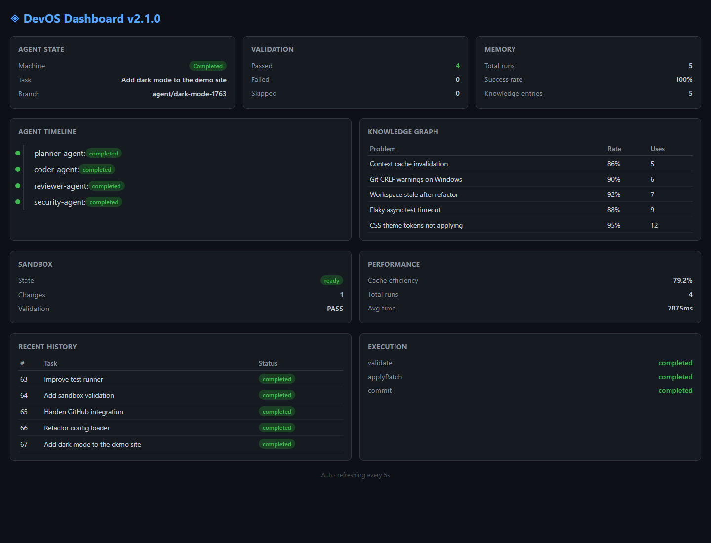

<p align="center">
  
</p>

<h1 align="center">DevOS</h1>

<p align="center">
  <strong>Autonomous AI software engineering orchestration framework.</strong><br>
  <code>Analyze → Plan → Modify → Validate → Remember → Explain</code>
</p>


> Package: `@marcu08/devos` · CLI binary: `devos`

DevOS is a Node.js framework that turns a coding task into a controlled engineering
pipeline. Instead of asking a model for a code snippet, DevOS scans the repository,
builds context, plans the change, generates and applies a unified diff inside a
Git-managed workspace, validates the result, heals failures, and records why each
decision was made.

> **Status:** early-stage developer tool. DevOS modifies files in a Git-managed
> `workspace/` copy and can execute validation commands. Review every change before
> merging it into your main tree.

---

## Table of contents

- [Why DevOS](#why-devos)
- [Features](#features)
- [Quick start](#quick-start)
- [Setup and authentication](#setup-and-authentication)
- [Commands](#commands)
- [Execution modes](#execution-modes)
- [How it works](#how-it-works)
- [Multi-agent orchestration](#multi-agent-orchestration)
- [Engines and modules](#engines-and-modules)
- [Memory and learning](#memory-and-learning)
- [Security](#security)
- [AI providers](#ai-providers)
- [Plugins](#plugins)
- [Dashboard](#dashboard)
- [Sandbox](#sandbox)
- [Configuration](#configuration)
- [Testing](#testing)
- [CI](#ci)
- [Documentation](#documentation)
- [Troubleshooting](#troubleshooting)
- [Contributing](#contributing)
- [License](#license)

---

## Why DevOS

AI coding assistants are good at producing code and bad at owning the process around
it. DevOS adds the missing engineering loop:

- **Repository-aware** — the context engine scans, ranks, and maps dependencies before
  a single line is generated.
- **Planned** — a reasoning stage extracts affected files, estimates confidence, and
  produces a structured plan.
- **Bounded** — changes are applied to a Git-managed workspace, not blindly to your
  working tree.
- **Verified** — syntax, runtime, Git, and lint validators decide whether a change is
  kept, retried, or rolled back.
- **Remembered** — every run, mistake, pattern, and successful solution is persisted
  and reused on later tasks.
- **Explainable** — decisions carry reasoning, confidence, evidence, and the files
  that changed.

---

## Features

| Capability | What it does |
|------------|--------------|
| Context engine | Scans the repo, ranks files by importance, builds a dependency graph |
| Reasoning engine | Analyzes the task, plans steps, scores confidence, self-reviews |
| Multi-agent mode | Coordinates planner, coder, reviewer, and security agents |
| Patch engine | Parses and applies unified diffs with context matching |
| Validation | Syntax, Node runtime, Git status, and ESLint checks |
| Healing loop | `PASS` keeps changes, `RETRY` heals and retries, `ROLLBACK` reverts |
| Memory | History, mistakes, patterns, solutions, similarity search, recommendations |
| Knowledge graph | Persistent entities and relationships extracted from runs |
| Security scanner | Secrets, unsafe patterns, dependencies, permissions, vulnerabilities |
| Explainability | Records the reasoning and evidence behind each decision |
| GitHub integration | Issue analysis, PR review, and PR creation through the GitHub API |
| Plugin system | Detection plugins, tools, validators, commands, context augmenters |
| Dashboard | Local web UI for state, validation, memory, knowledge, and sandbox |
| Sandbox | Isolated copy for comparing and validating changes before applying |
| Execution modes | Autonomous, assisted, and safe approval policies |

---

## Quick start

### Requirements

- **Node.js 18+**
- **Git**
- Optional: **OpenCode CLI** for the `opencode` AI provider
- Optional (Windows): **PowerShell 7** for the `.ps1` setup scripts

There are no runtime npm dependencies. A fresh clone runs with `node` alone;
`npm install` is only needed for development tooling.

### Install

```bash
git clone https://github.com/Marcu08/DevOS.git
cd DevOS
node cli.js doctor
```

`doctor` verifies Git, Node.js, npm, and the workspace:

```text
Environment Health Check
  ✓ git        git version 2.x
  ✓ node       v18+
  ✓ npm        10+
  ✓ workspace  master
  All checks passed
```

### Run your first task

```bash
node cli.js run "add input validation to the config loader"
```

The pipeline reports context analysis, planning, execution, validation, and the final
state. Artifacts are written to `logs/`:

```bash
node cli.js explain      # why the decision was made
node cli.js history      # past runs
node cli.js memory       # memory and error statistics
node cli.js validate     # re-run validators on the workspace
node cli.js rollback     # discard the workspace changes
```

---

## Setup and authentication

DevOS works without credentials by using the deterministic fallback provider, but
real AI providers, GitHub integration, and optional Supabase features need
authentication.

### Interactive setup

```bash
npm ci
npm run setup
# or
node cli.js setup
```

The wizard prompts for AI provider keys, a GitHub token, and optional Supabase
credentials. It writes a gitignored `.env` file in the project root and never prints
secrets in full.

```bash
node cli.js setup --check          # show which credentials are configured
node scripts/setup.js --non-interactive   # write .env from the current environment
```

`npm install` runs a short postinstall notice when `.env` is missing; it never
prompts automatically, so CI installs stay non-interactive.

### Precedence

1. Process environment variables (`ANTHROPIC_API_KEY`, `GITHUB_TOKEN`, ...)
2. `.env` in the project root
3. Built-in defaults

Environment variables always win, so CI secrets are never overridden by a local
`.env`.

### Supabase (optional)

DevOS does not require Supabase. The optional CI workflow uses these repository
secrets when present:

| Secret | Purpose |
|--------|---------|
| `SUPABASE_ACCESS_TOKEN` | Authenticates the Supabase CLI |
| `SUPABASE_PROJECT_REF` | Supabase project reference |
| `SUPABASE_DB_PASSWORD` | Required only for `supabase db push` |

Without `SUPABASE_ACCESS_TOKEN` and `SUPABASE_PROJECT_REF`, the workflow skips with a
notice instead of failing.

---

## Commands

All commands run through `cli.js`:

```bash
node cli.js <command> [args]
```

| Command | Description |
|---------|-------------|
| `run <task>` | Run the DevOS agent pipeline with a task |
| `orchestrate <task>` | Run the multi-agent orchestration pipeline |
| `doctor` | Run environment health checks |
| `setup` | Configure AI, GitHub, and Supabase credentials |
| `validate` | Run all validators on the current workspace |
| `rollback` | Roll the workspace back to the last clean state |
| `security` | Run a security scan on the current project |
| `history` | Show execution history |
| `memory` | Show memory, knowledge graph, and error statistics |
| `explain [task] [--all]` | Explain decisions with reasoning, confidence, and evidence |
| `mode [autonomous\|assisted\|safe]` | Set or view the execution mode |
| `sandbox create\|status\|compare\|clean` | Manage the isolated sandbox environment |
| `performance` | Show execution time, cache, and agent duration metrics |
| `providers` | List standalone AI providers and availability |
| `plugins [search\|install\|uninstall\|info]` | Manage plugins |
| `issue analyze <number>` | Analyze a GitHub issue |
| `pr review <number>` | Review a GitHub pull request |
| `pr create <title>` | Create a GitHub pull request |
| `dashboard` | Start the local web dashboard on port 3000 |
| `config` | Show the current DevOS configuration |
| `help` | Show the command list |

See [`docs/Commands.md`](docs/Commands.md) for detailed examples.

### Common workflows

```bash
# Single-agent pipeline
node cli.js run "refactor the config loader"

# Multi-agent review
node cli.js orchestrate "harden the API layer"

# Security-only pass
node cli.js security

# Investigate the last decision
node cli.js explain
node cli.js explain --all

# Safe mode: require approval for every operation
node cli.js mode safe

# Isolated experiment
node cli.js sandbox create
node cli.js sandbox compare
node cli.js sandbox clean
```

---

## Execution modes

The active mode is stored in `logs/mode.json` and can be changed with
`node cli.js mode <mode>`:

| Mode | Approval | Parallel agents | Use case |
|------|----------|-----------------|----------|
| `autonomous` (default) | None | Yes | Trusted local experiments |
| `assisted` | Execution and dangerous operations | Yes | Normal development |
| `safe` | Every operation | No | Untrusted repositories |

Dangerous operations include dependency manifests, security files, database
migrations, certificates, container configuration, and CI workflows.

---

## How it works

```
Task
  │
  ▼
┌─────────────────────────────────────────────────────────────┐
│ CONTEXT ENGINE                                              │
│ scan → rank → dependency map → plugin detection             │
└──────────────────────────┬──────────────────────────────────┘
                           ▼
┌─────────────────────────────────────────────────────────────┐
│ REASONING ENGINE                                            │
│ analyze → plan → confidence score → self-review             │
└──────────────────────────┬──────────────────────────────────┘
                           ▼
┌─────────────────────────────────────────────────────────────┐
│ EXECUTOR                                                    │
│ generate PR → validate → apply unified diff → commit        │
└──────────────────────────┬──────────────────────────────────┘
                           ▼
┌─────────────────────────────────────────────────────────────┐
│ VALIDATOR ENGINE                                            │
│ syntax → node run → git status → lint                       │
└──────────────────────────┬──────────────────────────────────┘
                           ▼
             ┌─────────────────────────────┐
             │ DECISION ENGINE             │
             │ PASS → keep changes         │
             │ RETRY → heal and retry      │
             │ ROLLBACK → revert workspace │
             └──────────────┬──────────────┘
                            ▼
┌─────────────────────────────────────────────────────────────┐
│ MEMORY + EXPLAINABILITY                                     │
│ history → mistakes → patterns → solutions → decisions       │
└─────────────────────────────────────────────────────────────┘
```

The pipeline runs against `workspace/`, a Git-managed copy of the project. The
workspace is prepared automatically at the start of `run`; `rollback` resets it, and
deleting it is safe because it is regenerated on the next run.

---

## Multi-agent orchestration

`node cli.js orchestrate "<task>"` runs a second pipeline in which specialized agents
coordinate explicitly:

```
Task
  │
  ▼
┌──────────────────────────────────────────────────────────────┐
│ ORCHESTRATOR                                                 │
│ assigns tasks, passes context, collects results, decides     │
└──┬──────────┬────────────┬────────────────┬──────────────────┘
   │          │            │                │
   ▼          ▼            ▼                ▼
┌──────┐ ┌────────┐ ┌──────────┐ ┌──────────────┐
│PLANNER│ │ CODER  │ │ REVIEWER │ │   SECURITY   │
└──┬────┘ └───┬────┘ └────┬─────┘ └──────┬───────┘
   └──────────┴───────────┴───────────────┘
                       │
                       ▼
             ┌───────────────────┐
             │  DECISION ENGINE  │
             │ COMMIT / RETRY /  │
             │ ROLLBACK          │
             └───────────────────┘
```

| Agent | File | Responsibility |
|-------|------|----------------|
| Planner | `agents/planner-agent.js` | Task analysis, risk assessment, priority, step planning |
| Coder | `agents/coder-agent.js` | Code generation, patch creation |
| Reviewer | `agents/reviewer-agent.js` | Code review, quality scoring, issue detection |
| Security | `agents/security-agent.js` | Security scanning, vulnerability detection |
| Orchestrator | `agents/orchestrator.js` | Coordination, context passing, decision engine |

---

## Engines and modules

| Engine | Location | Description |
|--------|----------|-------------|
| Context | `agent/context/` | Repository scan, file ranking, dependency graph |
| Reasoning | `agent/reasoning/` | Analysis, planning, confidence, self-review |
| Orchestrator | `agents/orchestrator.js` | Multi-agent coordination and decisions |
| Executor | `agent/executor.js`, `agent/executor/` | PR validation, patch application, commit, rollback |
| Patch engine | `agent/patch-engine/` | Unified diff parser, context-matched applier, generator |
| Validator | `agent/validator/` | Syntax, Node runtime, Git, and lint checks |
| Pipeline | `agent/pipeline/` | Context → reasoning → execution → validation → healing |
| State machine | `agent/state.js` | Idle → Planning → Executing → Validating → Completed |
| Memory | `agent/memory/` | History, mistakes, patterns, solutions, search, similarity |
| Knowledge graph | `agent/memory/knowledge/` | Persistent entities and relationships |
| Security | `agent/security/` | Secrets, patterns, dependencies, permissions, vulnerabilities |
| Explainability | `agent/explain/` | Decision recording, reasoning, confidence, evidence |
| Approval | `agent/approval/` | Execution modes and approval policies |
| Sandbox | `agent/sandbox/` | Isolated copy, comparison, cleanup |
| Performance | `agent/performance/`, `agent/cache/` | Run metrics and cache statistics |
| Plugins | `plugins/` | Detection, tools, validators, commands, marketplace |
| Providers | `providers/` | Standalone AI provider abstraction |
| AI chain | `agent/ai/` | OpenCode → direct API → local fallback |
| GitHub | `agent/github/` | Issues, pull requests, API client |
| Tools | `agent/tools/` | ESLint, npm, tests, doctor runners |
| CLI | `agent/cli/` | Command registry, output, commands |
| Dashboard | `dashboard/` | Local web UI on port 3000 |

### Project layout

```
DevOS/
├── agent/                  Core engines, CLI, executor, memory, security
├── agents/                 Multi-agent system (planner, coder, reviewer, security)
├── providers/              Standalone AI provider abstraction
├── plugins/                Detection plugins and marketplace
├── dashboard/              Local web dashboard
├── config/                 devos.json and mode.json
├── docs/                   Guides and command reference
├── examples/               Demo project and scripts
├── logs/                   JSON logs from the last runs
├── tests/                  Test suites and custom runner
├── workspace/              Git-managed working copy (generated, gitignored)
├── backup/                 File backups (gitignored)
└── cli.js                  CLI entry point
```

---

## Memory and learning

Every run feeds a persistent memory layer:

- **History** — task, status, confidence, risk, duration, and steps.
- **Mistakes** — failures with error, file, and pipeline stage.
- **Patterns** — success/failure signals per file and task type.
- **Solutions** — successful solutions keyed by task for reuse.
- **Search and similarity** — find related runs and past failures.
- **Recommendations** — warnings and suggestions before a retry.
- **Knowledge graph** — entities and relationships extracted across runs.

```bash
node cli.js memory
node cli.js history
node cli.js explain --all
```

Memory data lives in `logs/memory-*.json`; the knowledge graph lives in
`logs/memory-knowledge.json`.

---

## Security

DevOS ships an autonomous security reviewer with five scanning modules:

| Module | File | Checks |
|--------|------|--------|
| Secrets | `agent/security/secrets.js` | API keys, passwords, tokens, private keys |
| Patterns | `agent/security/patterns.js` | `eval`, `innerHTML`, injection, path traversal |
| Dependencies | `agent/security/dependencies.js` | Unsafe packages, loose versions, install scripts |
| Permissions | `agent/security/permissions.js` | Sensitive files, `.gitignore` compliance |
| Vulnerabilities | `agent/security/vulnerabilities.js` | Debug logging, empty catches, common mistakes |

```bash
node cli.js security
```

The scanner reads the actual contents of source files under the project root. It does
not trust `context.topFiles[].content` metadata, which only contains file summaries.
It skips binaries, symlinks, generated directories, and files above the configured
size limit, and reports unreadable files instead of treating them as empty.
Environment files such as `.env` and `.env.local` are included in secret scanning;
placeholder-only templates such as `.env.example` do not generate secret findings.
Directory symlinks are revalidated before traversal, and a symlinked workspace root
is rejected. Source reads are bounded to the configured limit plus one byte, so a
file that grows during a read cannot force an unbounded allocation.

Portable Node cannot fully eliminate a parent-directory swap between validation and
child path resolution; the scanner narrows that window, skips symlinks, and fails
closed when identity changes are observed.

If the scan cannot complete (missing workspace, unreadable file, file limit, or a
scanner exception), the command exits non-zero and the decision is `ERROR`; an empty
findings list alone is never reported as a successful scan. A failure in one source
scanner is recorded with its file and category while the remaining scanners and
files continue to run. Dependency and permission sub-scans are isolated from each
other, and scan errors never include raw exception text or stack traces.

Finding labels and remediation are taken from trusted static metadata by rule ID;
dependency names, script names, scanner-provided messages, and source values are
never copied into findings. A present but unreadable, malformed, or symlinked
`package.json`, or valid JSON that is not an object root, makes the scan incomplete
(`ERROR`); a missing manifest remains a no-op. Findings include a rule id, severity, relative
file path, line number when available, and a remediation.

Security findings influence the pipeline decision (`PASS` / `RETRY` / `ROLLBACK` /
`ERROR`). Raw secret values and source snippets are not included in findings or logs.

Additional safeguards:

- API keys are passed through environment variables to isolated child processes,
  never through command-line arguments.
- The patch engine validates context lines before applying a diff, so stale hunks are
  skipped instead of corrupting files.
- `workspace/` isolates pipeline changes from your main working tree.
- Security source scanning excludes binaries, symlinks, generated directories, and
  oversized files; it reports incomplete scans explicitly.
- Execution modes add approval gates for dangerous operations.

> **Warning:** DevOS executes generated code and validation commands. Use it on a
> clean Git tree, review diffs before merging, and prefer `safe` mode on untrusted
> repositories.

---

## AI providers

DevOS has two provider layers.

### Pipeline chain (`agent/ai/`)

Patch generation tries providers in order:

| Order | Provider | Requirements |
|-------|----------|--------------|
| 1 | `opencode` | OpenCode CLI in `PATH` (Windows `.cmd` shims handled) |
| 2 | `direct` | `ANTHROPIC_API_KEY` or `OPENAI_API_KEY` |
| 3 | `fallback` | None — deterministic local patches, useful for smoke tests |

The fallback produces placeholder commentary, not real AI-generated code. Configure a
real provider for meaningful changes.

### Provider abstraction (`providers/`)

`providers/` exposes a standalone `generate()`, `analyze()`, `review()` interface for
OpenAI, Anthropic, DeepSeek, and a local simulated provider. It is used by
integrations and tests; the default pipeline uses the `agent/ai` chain above.

```js
const providers = require("./providers");
const result = await providers.generate("prompt", "openai");
```

### Environment variables

| Variable | Purpose |
|----------|---------|
| `ANTHROPIC_API_KEY` | Anthropic (direct chain and provider abstraction) |
| `OPENAI_API_KEY` | OpenAI (direct chain and provider abstraction) |
| `DEEPSEEK_API_KEY` | DeepSeek (provider abstraction) |
| `GITHUB_TOKEN` / `GH_TOKEN` | GitHub issue and PR operations |
| `DEVOS_ROOT` | Override the project root (normally set by `cli.js`) |
| `DEVOS_NO_CACHE` | Set to `1` to bypass the context cache |
| `DEVOS_OPENCODE_BIN` | Override the OpenCode binary name/path |
| `SUPABASE_URL`, `SUPABASE_ANON_KEY` | Optional Supabase REST credentials |
| `SUPABASE_SERVICE_ROLE_KEY` | Supabase server-side key (never expose to a browser) |
| `SUPABASE_ACCESS_TOKEN`, `SUPABASE_PROJECT_REF`, `SUPABASE_DB_PASSWORD` | Optional Supabase CLI/CI authentication |

---

## Plugins

DevOS detects the project stack and activates matching plugins. Built-in plugins:
`javascript`, `python`, `react`, `docker`, and `graphql`.

A plugin can contribute detection rules, tools, validators, CLI commands, context
augmenters, and prompt injections:

```js
// plugins/my-plugin.js
module.exports = {
  name: "my-plugin",
  version: "1.0.0",
  description: "Support for my stack",
  detect: [".ext", "config-file", "keyword"],
  tools: ["lint", "test"],
  rules: ["Prefer the project error wrapper"],
};
```

```bash
node cli.js plugins                     # list installed
node cli.js plugins search <query>      # search the marketplace
node cli.js plugins install <name>      # install a plugin
node cli.js plugins uninstall <name>    # uninstall
node cli.js plugins info <name>         # show the manifest
```

The marketplace ships additional entries such as `security`, `typescript`, `rust`,
`go`, `ruby`, and `php`. See [`plugins/SKILL.md`](plugins/SKILL.md) and
[`plugins/v2-specification.md`](plugins/v2-specification.md) for the plugin contract.

---

## Dashboard

```bash
node cli.js dashboard
```

<p align="center">
  
</p>

_<small>Preview with demo data.</small>_

Open <http://localhost:3000>. The dashboard is read-only and reads the JSON logs:
agent state, validation results, memory totals, knowledge graph, sandbox status,
agent timeline, and recent runs.

The server binds to localhost only and has no authentication. Do not expose port 3000
to an untrusted network.

---

## Sandbox

The sandbox creates an isolated copy of the project (excluding `node_modules`, `.git`,
logs, backups, and the workspace) so you can compare and validate changes separately:

```bash
node cli.js sandbox create    # copy the project into sandbox/
node cli.js sandbox status    # state, file counts, validation
node cli.js sandbox compare   # diff original vs sandbox
node cli.js sandbox clean     # remove the sandbox
```

Sandbox data lives in `sandbox/` at the repository root.

---

## Configuration

Main configuration: [`config/devos.json`](config/devos.json).

| Key | Description |
|-----|-------------|
| `version`, `name` | Project metadata |
| `editor` | Editor command used by integrations |
| `ai.provider` | Active AI provider (`opencode`, `direct`, `fallback`) |
| `validator.syntax`, `.git`, `.lint`, `.node` | Enable individual validators |
| `validator.command` | Runtime check command (default `node index.js`) |
| `validator.retry` | Maximum healing attempts |
| `tools.npm`, `.eslint`, `.tests` | Enable tool runners |
| `memory.enabled`, `.maxHistory`, `.maxMistakes`, `.maxPatterns`, `.maxSolutions` | Memory limits |
| `reasoning.confidenceThreshold` | Minimum confidence to execute (default `0.6`) |
| `reasoning.maxHealingRetries` | Retry budget (default `3`) |
| `workspace.maxFiles` | Maximum files copied into the Git-managed workspace (default `200`) |
| `security.maxFiles` | Maximum source files scanned before the scan is marked incomplete (default `2000`) |
| `security.maxFileSizeBytes` | Maximum file size scanned for source findings (default `1048576`) |
| `security.exclude` | Extra directory/file names or relative paths excluded from source scanning |
| `logging.directory` | Log directory |
| `logging.state`, `.context`, `.execution`, `.report`, `.reasoning` | Enabled logs |

The project root is resolved from `DEVOS_ROOT`, then the repository location, so a
clone works from any path. Execution mode lives in `logs/mode.json` (runtime state,
gitignored) and is managed with `node cli.js mode`.

---

## Testing

```bash
npm test
# or
node tests/runner.js

# coverage report (c8)
npm run test:coverage
```

The suite currently covers **23 test suites and 526 assertions**, all passing:

- Patch engine (parser, applier, generator, round-trip)
- State machine and execution flow
- Memory (history, mistakes, patterns, solutions, search, similarity, knowledge graph)
- Plugins and marketplace
- CLI, output, and command routing
- Config, providers, similarity, security
- Multi-agent orchestration
- GitHub integration and explainability
- Approval modes, sandbox, and performance metrics

The custom runner discovers every `tests/*.test.js` file and exits non-zero on failure.
See [`tests/README.md`](tests/README.md) for the assertion API and test hygiene rules.

### Runner options

```bash
node tests/runner.js --list              # list discovered suites
node tests/runner.js --filter=config     # run matching suites only
node tests/runner.js --bail              # stop at the first failing suite
node tests/runner.js --isolate           # fresh require cache per suite
node tests/runner.js --verbose           # show suite logs
node tests/runner.js --json              # machine-readable report for CI
node tests/runner.js --timeout=60000     # per-suite timeout (0 disables)
```

### Benchmarks

```bash
npm run bench               # report startup and context timings
npm run bench -- --check    # fail when a threshold is exceeded
```

The benchmark measures `help`, `config`, `mode`, cold context build, and warm
context build. CI runs the threshold check on Node 22. Context results are cached in
`logs/cache/` and reused while file `mtime`/size fingerprints are unchanged; set
`DEVOS_NO_CACHE=1` to bypass the cache.

---

## CI

Two GitHub Actions workflows live in `.github/workflows/`:

- **`ci.yml`** runs the test suite on Node 18, 20, and 22 across Ubuntu and Windows,
  plus `npm run lint`, a runtime `npm audit`, a startup benchmark threshold check, and
  a coverage report on Node 22.
- **`supabase.yml`** validates the optional Supabase configuration on manual
  dispatch or changes under `supabase/`. It installs the Supabase CLI, verifies
  authentication, links the project, and pushes migrations when
  `supabase/config.toml` and `supabase/migrations/` exist. Missing secrets produce a
  notice and a clean skip.

Add the secrets listed in [Setup and authentication](#setup-and-authentication) to
the repository before enabling the Supabase workflow.

---

## Documentation

- [`docs/Commands.md`](docs/Commands.md) — command reference and examples
- [`docs/getting-started.md`](docs/getting-started.md) — setup walkthrough
- [`docs/workflow.md`](docs/workflow.md) — workflow notes
- [`docs/demo.md`](docs/demo.md) — demo walkthrough
- [`docs/WezTerm.md`](docs/WezTerm.md) — terminal setup
- [`dotfiles/README.md`](dotfiles/README.md) — optional personal configuration
- [`CONTRIBUTING.md`](CONTRIBUTING.md) — development and pull request guide
- [`SECURITY.md`](SECURITY.md) — security policy and secret handling
- [`CHANGELOG.md`](CHANGELOG.md) — release history

---

## Troubleshooting

| Symptom | Fix |
|---------|-----|
| `git` or `node` not found | Install the requirement and rerun `node cli.js doctor` |
| Pipeline returns placeholder comments | No AI provider configured; set `ANTHROPIC_API_KEY`/`OPENAI_API_KEY` or install the OpenCode CLI |
| `opencode` provider not detected | Install the OpenCode CLI and ensure it is in `PATH`, or set `DEVOS_OPENCODE_BIN` |
| `run` fails while patching | Ensure `workspace/` can be created; delete it and rerun, or run `node cli.js rollback` |
| Dashboard port 3000 already in use | Stop the other process or change `PORT` in `dashboard/server.js` |
| Workspace is dirty after a failed run | `node cli.js rollback`, or delete `workspace/` and rerun |
| Tests fail after a change | Run `node tests/runner.js` and inspect the failing suite output |
| Permission denied on Windows | Close editors holding the file, run from a normal terminal, and retry |

---

## Contributing

1. Fork the repository and create a feature branch.
2. Keep changes scoped and add or update tests in `tests/`.
3. Run `npm test`, `npm run lint`, and `npm run bench -- --check`.
4. Describe the behavior change, the root cause, and the verification you ran.

See [`CONTRIBUTING.md`](CONTRIBUTING.md) for the full guide and
[`SECURITY.md`](SECURITY.md) for vulnerability reporting and secret handling.

Bug reports and pull requests are welcome at
<https://github.com/Marcu08/DevOS>.

---

## License

Released under the [MIT License](LICENSE).

---

## Credits

Built as an orchestration layer for autonomous software agents. Inspired by the idea
that AI coding tools should be accountable for the full engineering loop —
analysis, execution, validation, memory, and explanation.
